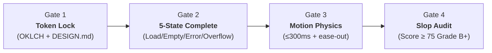

# 🛡️ Vanguard UI (`vanguard-ui`)

> **The definitive anti-AI-slop Frontend & SaaS UI Engineering skill for AI coding agents.**  
> Compatible with **Claude Code**, **Google Antigravity**, **Cursor**, **Codex CLI**, and **skills.sh** (`npx skills add`).

[](https://opensource.org/licenses/MIT)
[](https://nodejs.org/)
[](package.json)
[](tests/audit.test.mjs)

```
╔══════════════════════════════════════════════════════════════════════╗
║                                                                      ║
║   ██╗   ██╗ █████╗ ███╗   ██╗ ██████╗ ██╗   ██╗██╗                   ║
║   ██║   ██║██╔══██╗████╗  ██║██╔════╝ ██║   ██║██║                   ║
║   ██║   ██║███████║██╔██╗ ██║██║  ███╗██║   ██║██║                   ║
║   ╚██╗ ██╔╝██╔══██║██║╚██╗██║██║   ██║██║   ██║██║                   ║
║    ╚████╔╝ ██║  ██║██║ ╚████║╚██████╔╝╚██████╔╝██║                   ║
║     ╚═══╝  ╚═╝  ╚═╝╚═╝  ╚═══╝ ╚═════╝  ╚═════╝ ╚═╝                   ║
║                                                                      ║
║                ANTI-AI-SLOP FRONTEND ENGINEERING                     ║
╚══════════════════════════════════════════════════════════════════════╝
```

---

## 🛑 What is "AI UI Slop"?

When AI agents generate modern web interfaces, they fall into repetitive, unpolished clichés:
- **The Purple/Indigo Gradient Cliché**: `from-purple-500 via-purple-600 to-indigo-700` everywhere.
- **Hardcoded Hex Values**: Scattering arbitrary `bg-[#8b5cf6]` across components instead of semantic tokens.
- **Missing SaaS States**: Rendering components assuming data is always present, with zero consideration for `loading`, `empty`, `error`, or `overflow`.
- **Layout Thrashing**: Throwing `transition-all duration-500 ease-in` on hoverable items.
- **Unbroken Text Blowups**: Missing `min-w-0` on flex items, causing German compound words, long emails, and URLs to destroy card boundaries.
- **Lack of Accessibility**: Slapping `onClick` on plain `<div>` elements without `role`, `tabIndex`, or keyboard event handlers.

**Vanguard UI** solves this by pairing **progressive-disclosure agent instructions** with **zero-dependency Node.js automation scripts**, **post-edit verification hooks**, and **deterministic scorecard auditing**.

---

## ⚡ Quick Start

### 1. Install via `skills.sh`
```bash
npx skills add vanguard-ui/vanguard-ui
```

### 2. Install as Claude Code Plugin
```bash
claude plugin add vanguard-ui
```

### 3. Install in Google Antigravity
Clone or copy into your workspace's `.agents/skills/` directory:
```bash
mkdir -p .agents/skills
cp -r skills/vanguard-ui .agents/skills/
```

### 4. Install via NPM / CLI
```bash
npm install -g vanguard-ui
# or run directly via npx:
npx vanguard-ui init
```

---

## 🏛️ The 4-Gate Workflow

Every AI agent equipped with `vanguard-ui` strictly follows the **4-Gate Workflow** before proposing or finalizing any UI code:



### Gate 1: Design System & Token Lock
- Never write raw hex colors or unconfigured Tailwind color classes.
- Lock semantic tokens in `DESIGN.md` and `tokens.css` using the **OKLCH** color space.
- Need inspiration? Run `vanguard-ui extract <url>` to pull live design tokens from Stripe, Linear, or Apple.

### Gate 2: 5-State SaaS Completeness
Every data-driven component or dashboard view MUST implement all 5 states:
1. **Loading**: Geometry-matched skeleton (not a generic spinner) with `aria-busy="true"`.
2. **Empty**: Contextual zero-state with headline, explanation, and an actionable CTA.
3. **Error**: Inline, non-destructive recovery button preserving user input.
4. **Overflow**: `min-w-0`, `truncate`, `tabular-nums` for all metrics and tables.
5. **Populated**: Fluid, responsive, and accessible happy path.

### Gate 3: Motion & Interaction Physics
- **Enter curve**: `cubic-bezier(0.22, 1, 0.36, 1)` (fast entrance, gentle settle).
- **Duration ceiling**: `≤ 200ms` for micro-interactions; never exceed `300ms`.
- **Compositor properties only**: Animate `transform` and `opacity` exclusively.
- **Accessibility**: Mandatory `motion-reduce:transition-none` media query on all animations.

### Gate 4: Deterministic Verification & Auto-Heal
- Every file write automatically executes `scripts/slop-audit.mjs` via lifecycle hooks.
- Code MUST achieve a score of **Grade B (≥ 75/100)** or higher before being presented.
- Any critical violation halts the agent turn and triggers an immediate auto-heal fix.

---

## 💻 CLI Commands

The zero-dependency CLI runs anywhere Node.js (>= 18) is installed:

### `vanguard-ui init`
Scaffolds a clean `DESIGN.md` and `tokens.css` with OKLCH CSS variables in the current directory:
```bash
vanguard-ui init
```

### `vanguard-ui audit <file-path> [--json]`
Runs the 25+ deterministic rule engine on any `.tsx`, `.jsx`, `.html`, or `.css` file:
```bash
vanguard-ui audit src/components/PricingTable.tsx
```

Outputs the viral ASCII terminal scorecard:
```
╔══════════════════════════════════════════════════════════════════════════╗
║  VANGUARD UI — SLOP AUDIT                                                ║
╠══════════════════════════════════════════════════════════════════════════╣
║  File:  Hero.tsx                                                         ║
║  Score: 32/100    Grade: F                                               ║
╠══════════════════════════════════════════════════════════════════════════╣
║  CRITICAL (3)                                                            ║
║  ✗ COL-001  AI purple gradient detected                        L14, L28  ║
║  ✗ MOT-001  transition-all causes unnecessary layout thrash    L45       ║
║  ✗ ACC-001  div onClick missing role and keyboard handler      L89       ║
╠──────────────────────────────────────────────────────────────────────────╣
║  WARNING (4)                                                             ║
║  ⚠ TYP-002  Currency metric missing tabular-nums               L34       ║
║  ⚠ LAY-003  Text inside flex container without min-w-0         L56       ║
╚══════════════════════════════════════════════════════════════════════════╝
```

### `vanguard-ui extract <url|file> [--output-dir <dir>]`
Extracts colors, fonts, radii, and shadows from a live URL or local HTML/CSS file, converts colors to OKLCH, and writes `DESIGN.md` and `tokens.css`:
```bash
vanguard-ui extract https://linear.app
```

### `vanguard-ui cad <component-path> [--output <path>]`
Parses padding, gap, radius, and typography tokens from a component and generates an Apple-style technical blueprint HTML file (`<component>.cad.html`) with SVG dimension lines:
```bash
vanguard-ui cad src/components/MetricCard.tsx
```

### `vanguard-ui stress [--output <path>]`
Generates adversarial test payloads (`stress-payloads.json`) with unbroken 120-character strings, RTL Arabic/Hebrew bidi text, extreme numbers, and 500-item arrays.
```bash
vanguard-ui stress
```

---

## 📋 Deterministic Audit Rules (25+ Rules)

| Rule ID | Category | Severity | Deduction | Description |
| :--- | :--- | :--- | :---: | :--- |
| `COL-001` | Color | **Critical** | -8 | Rejects default AI purple/indigo/violet gradients (`from-purple-`, `via-indigo-`). |
| `COL-002` | Color | **Critical** | -5 | Rejects arbitrary hardcoded Tailwind hex (`bg-[#...]`, `text-[#...]`). |
| `COL-003` | Color | Warning | -3 | Flags pure `#000` text on `#fff` without surface layering tokens. |
| `COL-004` | Color | **Critical** | -8 | Flags signature AI slop hex colors (`#8b5cf6`, `#6366f1`, `#a855f7`). |
| `COL-005` | Color | **Critical** | -6 | Rejects inline `linear-gradient` containing AI purple/indigo hexes. |
| `TYP-001` | Typography | Warning | -3 | Flags unconfigured default `font-sans` when no custom `--font-` variable exists. |
| `TYP-002` | Typography | Warning | -3 | Enforces `tabular-nums` on currency, metrics, percentages, and table numbers. |
| `TYP-003` | Typography | Warning | -2 | Enforces `tracking-tight` on display headings (`text-4xl` and above). |
| `TYP-004` | Typography | Info | -1 | Recommends `text-balance` on multi-line headings to eliminate orphans. |
| `TYP-005` | Typography | Warning | -2 | Flags large display text lacking tight line-height (`leading-tight`). |
| `LAY-001` | Layout | **Critical** | -6 | Detects "cards-inside-cards" (nested rounded + border/shadow + padding). |
| `LAY-002` | Layout | Warning | -4 | Detects "icon tile above every heading" cliché (3+ repeated siblings). |
| `LAY-003` | Layout | Warning | -3 | Enforces `min-w-0` or `truncate` on text elements inside flex/grid containers. |
| `LAY-004` | Layout | Warning | -2 | Flags `h-screen` or `100vh` without `100dvh` fallback on mobile. |
| `LAY-005` | Layout | Warning | -2 | Flags fixed pixel widths (`w-[800px]`) lacking responsive variants. |
| `LAY-006` | Layout | Warning | -2 | Flags excessive nesting depth (> 4 levels of styled containers). |
| `MOT-001` | Motion | **Critical** | -5 | Rejects `transition-all` on interactive UI elements (causes layout thrash). |
| `MOT-002` | Motion | Warning | -3 | Rejects `ease-in` on enter transitions (feels sluggish). |
| `MOT-003` | Motion | Warning | -3 | Rejects animation durations > 300ms on interactive controls. |
| `MOT-004` | Motion | Warning | -3 | Rejects transitions/animations missing `motion-reduce:transition-none`. |
| `MOT-005` | Motion | Warning | -2 | Flags animating non-compositor properties (width, height, top, left, margin). |
| `STA-001` | State | Warning | -4 | Flags `.map()` called without checking for an empty array / fallback. |
| `STA-002` | State | Warning | -3 | Flags client data-fetching without an explicit loading state / skeleton. |
| `STA-003` | State | Warning | -3 | Flags asynchronous operations lacking non-destructive error handling. |
| `ACC-001` | A11y | **Critical** | -5 | Rejects `<div onClick>` or `<span onClick>` lacking `role`, `tabIndex`, or keyboard handlers. |
| `ACC-002` | A11y | Warning | -2 | Enforces matching `focus-visible:` styles on elements with `hover:` states. |

---

## 🌐 Platform Compatibility Matrix

| Platform | Integration Method | Automatic Verification | File Format |
| :--- | :--- | :---: | :--- |
| **Claude Code** | `.claude-plugin/marketplace.json` | Ready | `skills/vanguard-ui/SKILL.md` |
| **Google Antigravity** | `.agents/skills/vanguard-ui` | ✅ Hooks active | `skills/vanguard-ui/SKILL.md` + `hooks.json` |
| **skills.sh** | `npx skills add vanguard-ui/vanguard-ui` | Ready | `SKILL.md` standard |
| **Cursor** | `.cursor/rules/vanguard-ui.mdc` | Manual / Prompt | Native Markdown format |
| **Codex CLI** | `codex plugin add vanguard-ui` | Ready | `SKILL.md` standard |

---

## 🧪 Testing

Run the native Node.js test suite:
```bash
npm test
```

This validates:
- `bad-ai-slop.tsx` triggers all expected anti-patterns and scores **< 40/100 (Grade F)**.
- `clean-component.tsx` achieves a **perfect 100/100 (Grade S)**.
- Token extraction and OKLCH color math.
- Stress test payload generator.
- CAD technical blueprint SVG generation.

---

## 📄 License

MIT © [Vanguard UI Contributors](LICENSE)
